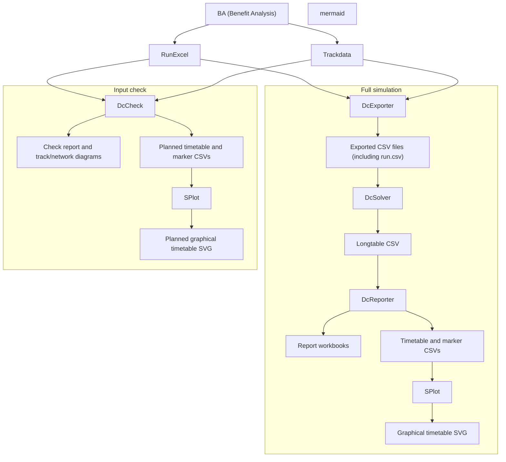

# TrainsSupply

**Railway power-supply modelling and simulation**

## Purpose

TrainsSupply simulates railway power-supply systems with moving trains. The
simulator combines railway infrastructure, an electrical grid and train
traffic to calculate voltages, currents and power flows over time.
See [Examples](#examples) for concrete study inputs and commands.

### Limitations

- The current release is limited to DC traction networks.
- Train movements and power demands are precalculated. Insufficient delivered
  power is detected, but its effect is not fed back into the train dynamics.

## Examples

### two_sections — Multi-leg traffic in both directions

The `two_sections` study contains five trains from A to D and five from D to A,
with a one-minute headway in each direction. Each train uses three RunExcel legs:

| Template | First leg | Second leg | Third leg |
| --- | --- | --- | --- |
| A-D | `A-D_timetable_A-B.xlsx` | `A-D_timetable_B-C.xlsx` | `A-D_timetable_C-D.xlsx` |
| D-A | `D-A_timetable_D-C.xlsx` | `D-A_timetable_C-B.xlsx` | `D-A_timetable_B-A.xlsx` |

The RunExcel files are located under
`D:\studies\dc-simulator-verifiering\references\two_sections`.
Trackdata contains the sheets `A-D` and `D-A`; each sheet's `trackInformation`
must match its route ID. Both views are configured in `dcsim.track.route_views`.

```bat
dcStudy --check D:\studies\dc-simulator-verifiering\conf\two_sections\two_sections.conf D:\studies\dc-simulator-verifiering
```

## Part 1 — Using TrainsSupply

### The study model

A study combines three descriptions: **track infrastructure** defines railway
positions, sections, stations and connections; the **electrical grid** defines
conductors, nodes and power installations; and **traffic** defines routes,
RunExcel templates and train departures. A template can contain several legs.
The main configuration brings these inputs together and defines the simulation
window. See [Examples](#examples) for a concrete study.

### Check and run

TrainsSupply is run from the command line or an IDE. Check the inputs first:

```bat
dcStudy --check <configuration-file> <working-directory>
```

The check validates inputs and exported train placements, and produces
reports and diagrams in the study's `checks` directory. No time step is solved.
Inspect the graphical timetable for intended routes, directions, stops and
unexplained position jumps.

After the check passes, run the simulation:

```bat
dcStudy <configuration-file> <working-directory>
```

The command exports traffic, solves the electrical network for each time step
and produces detailed results and summary workbooks.

### Validate and archive

Validate representative traction, regenerative braking and train interactions.
Confirm physically consistent voltages, currents, power flows and losses;
a successful input check does not guarantee convergence or power availability.

Keep configurations, required inputs, selected reference results and a
study-specific `README.md` in Git. Record commands and assumptions needed for
reproduction, including access to externally referenced files. Generated
calculation output is normally working data.

## Part 2 — Developing TrainsSupply

### Architecture overview



The application separates input preparation, electrical calculation and
reporting. The Gradle task `dcStudy` runs the tasks `dcExporter`, `dcSolver` and
`dcReporter` in that order. They invoke `DcExporter.main`, `DcSolver.main` and
`DcReporter.main` to export traffic, solve the electrical network and produce
reports.

Track transformations connect route coordinates with physical track sections
and model positions. Reporting introduces a further coordinate: distance along
the configured graphical-timetable base route. Keep these coordinates distinct
when tracing a train through the application.

The stories below describe concrete execution paths. Each story records calls and intermediate data so another developer can
follow the execution path. Concrete study inputs are described in Examples.

### Story 1 — Check multi-leg traffic and draw its complete timetable

The task `dcCheck` invokes `DcCheck.main` to verify inputs without
solving time steps. `dcCheckGt` depends on `dcCheck` and then invokes the external
SPlot task `:tools:splot:splotCsv` to render the planned timetable. `dcStudyGt`
adds the same rendering step after a full study.

#### Execution sequence

1. **Gradle `dcCheckGt` -> `dcCheck` -> `DcCheck.main(args)`:** load the study
   with `DcStudyContextLoader.load(conf)` and call `DcCheck.run(context, routeId)`.
   Gradle supplies the working directory through `studyWorkingDir`.
2. **`DcCheck.run` -> input loaders:** call `GridModelLoader.load(dcsim)`,
   `TrackConfigLoader.load(dcsim, confFile)`, `SystemParametersFactory.build(dcsim)`
   and `RouteFactory.build(traffic)`. Construct `DefaultTrackTransformService`
   from the loaded track and call `CalculationNetworkBuilder.buildBase(grid)`.
   Each input stage is wrapped by `DcCheck.stage` to record success or failure.
3. **`DcCheck.run` -> diagnostic writers:** call `TrackRouteDiagram.write`,
   `ElectricalRouteCheck.inspect` and `ElectricalTopologyGraph.write` to produce
   track diagrams and electrical route diagnostics in `checks`.
4. **`DcCheck.run` -> `RunCsvWriter.write(dcsim, confFile, temporary)`:** export
   traffic into a temporary directory. Load its `run.csv` with
   `RunSampleLoader.load(runCsv)` to obtain `List<RunSample>`.
5. **`DcCheck.run` -> `checkPlacements`:** call
   `TrainPositionFactory.fromRunSamples(List.of(sample))` for each sample and
   `TrainNodeInserter.insertTrainNodes(network, List.of(train))` for each distinct
   placement. Check train IDs, route IDs and finite time, position and power.
6. **`DcCheck.run` -> `NetworkInputCsvWriter`:** call `writeTrackStations` and
   `writeTrackSegments` with the loaded track to create `track_stations.csv` and
   `track_segments.csv` in the temporary directory.
7. **`DcCheck.run` -> `DcReporter.writePlannedGraphicalTimetable(context,
   temporary, samples, transform, checks)`:** use the five-argument overload
   accepting `List<RunSample>`. It constructs `TrainPositionFactory`, calls
   `fromRunSamples(List.of(sample))`, and creates
   `PlannedTimetablePoint(timeS, trainId, sectionId, positionM)` values.
8. **`DcReporter` -> points overload and base-route mapping:** call
   `writePlannedGraphicalTimetable(context, exportDirectory, points,
   outputDirectory)` and `loadBaseRoutePositionMapper`. Read
   `report.graphical-timetable.base-route.sections` and `track_segments.csv`.
   If `base-route.id` is supplied, `loadReversedBaseRouteSections` uses
   `TrackConfigLoader.load` and `routeDirections` to determine section orientation.
9. **`DcReporter` -> timetable and marker CSVs:** map each point with
   `BaseRoutePositionMapper.map(sectionId, positionM)` and write
   `<studyId>_graphical_timetable.csv` in `checks`, with columns
   `time_s,train_id,base_route_position_m,p_delta_W`. Planned points use `0.0`
   for power deficit. Unmapped positions leave an empty position field.
   `writeGraphicalTimetableMarkers` writes station, supply-point and
   section-boundary markers to `<studyId>_graphical_timetable_markers.csv`.
10. **`DcCheck.run` -> check report:** delete the temporary directory in
    `finally`, write `<studyId>_input_check.txt` and return `CheckResult`.
    `DcCheck.main` prints the report and throws if the result is invalid.
11. **Gradle `dcCheckGt` -> external SPlot Gradle wrapper:** after `dcCheck`
    succeeds, invoke `:tools:splot:splotCsv` with `-Pinput`, `-Pmarkers`,
    `-Poutput` and `-Ptitle`. Input and output paths refer to `checks`;
    the output is `<studyId>_graphical_timetable.svg`. The external project is
    selected by `splotProjectDir` or `SPLOT_PROJECT_DIR`.

### Story 2 — Railway coordinates and electrical routes

#### Problem

Traffic describes movement along a journey, while electrical infrastructure must identify a physical location independently of travel direction. Railway kilometre references can increase or decrease, restart in another section, and cover a physical distance different from their numerical difference. A single position in metres cannot represent all these meanings.

The implementation therefore separates path positions, railway coordinates and model coordinates. It also separates a track route view from an electrical route. Both use a route ID, but serve different purposes.

| Representation | Meaning | Code |
| --- | --- | --- |
| Path position | Position along a particular route view, as supplied by traffic | `PathSample`, `RouteView` |
| Railway coordinate | Section, kilometre reference and optional track ID | `RwyCoordinate` |
| Model coordinate | Section, optional track ID and physical model position within that section | `ModelCoordinate` |
| Electrical route | Permitted source line IDs for feeding and return connections | `org.supply.domain.Route` |

#### Design decisions and difficulties

Infrastructure geometry is defined once. Opposite travel directions use separate route views over that geometry. Reversing a journey must not rebuild or reverse the physical section model.

Within each section, kilometer boards retain their configured order. The `length` of a board defines the physical distance to the next board. It must not be replaced with the numerical difference between kilometre references. Model position starts at zero independently in each section.

A route view provides samples linking path positions to railway coordinates. Interpolation is valid only within the same section and track. At a section or track change, the current implementation permits a transition interval of at most one metre. It does not interpolate kilometre references across that boundary.

Electrical route membership and physical placement are separate conditions. A train must lie on the appropriate section and a compatible track, and the branch must belong to its electrical route. Line endpoints are handled in either positional order.

#### Implementation sequence

1. **Load the section model.** `org.supply.track.TrackConfigLoader.load(dcsim, confFile)` reads `track.kilometer_boards`, `track.junctions` and configured stations, then calls `TrackLoader.load(...)`. `TrackLoader` groups boards by section without sorting. Consecutive boards become `RouteSegment` instances, using the first board's length to the next board and an accumulated section-local model position. Each section requires at least two boards. Junctions are retained in the loaded model.

2. **Load the route views.** `TrackConfigLoader` reads `track.route_data_excel` and `track.route_views`, which must be configured together. Relative workbook paths resolve against the configuration file's directory. For every configured view, `RouteViewExcelReader.read(workbookPath, sheetName, routeId)` reads `position [m]`, `trackSection`, `bisKm` and `bisMeter`, with optional `trackNumber` and `trackInformation`. The configured route ID is authoritative. Nonblank `trackInformation` must match it. Duplicate configured route IDs are rejected. The reader also requires explicit km+000 rows for each whole kilometre reference covered by each contiguous section/track interval.

3. **Load station events.** `TrackStationExcelReader.read(...)` accepts named rows with `dataType = P` and identical `fromStationAbbr` and `toStationAbbr`. Unequal names describe an interval and are not interpreted as a station event. `merge(...)` replaces configured stations whose names occur in Excel, then deduplicates exact events by name, section, railway position and track. Multiple distinct positions with the same station name remain distinct events.

4. **Load electrical routes.** `org.supply.loader.RouteFactory.build(traffic)` reads `traffic.routes`. Each route contains its ID and the configured `feeding_lines` and `return_lines`. This step creates line references; it performs no coordinate transformation or adjacency check.

5. **Transform a traffic position.** `TrainPositionFactory.fromRunSamples(...)` calls `DefaultTrackTransformService.pathToModel(routeId, positionM)`. The service calls `pathToRailway(...)`, which looks up the route view and delegates to `RouteViewMapper.toRailway(...)`. Exact sample positions return their stored railway coordinates. Positions between samples on the same section and track use linear interpolation rounded to whole metres. Within an allowed section/track transition interval, the preceding coordinate is used; the next sample itself selects the new coordinate. Nonfinite positions, unknown routes and positions outside the route range are rejected.

6. **Transform to section-local model position.** `DefaultTrackTransformService.toModel(...)` selects the section from the railway coordinate and calls `TrackSectionMapper.toModel(...)`. The mapper finds a segment containing the railway reference and scales the offset by the segment's configured physical length, rounding to whole metres. It preserves the coordinate's track ID. Increasing and decreasing kilometre references are supported. A nonzero model segment with identical railway endpoints cannot be mapped.

7. **Select electrical connections.** `org.supply.solver.build.TrainNodeInserter.insertTrainNodes(...)` uses the resulting `CalculationTrainPosition`. `routeContains(...)` matches a branch's `sourceId` against the route's feeding or return line IDs. Both endpoints must match the train's section and have compatible track IDs. A blank track ID on either side acts as a wildcard. If routes are configured, an unknown train route cannot select a branch. If no routes are configured, the implementation permits placement without route filtering for compatibility.

8. **Connect feeding and return.** A train at an eligible endpoint reuses that node. A train strictly inside an eligible branch receives a train node, and the branch is split in endpoint order with resistance proportional to physical segment length. Placement must provide both a feeding node and a return node; otherwise insertion fails. The details of rebuilding the dynamic network belong to Story 3.

#### Example: two_sections

Both route views describe the same 4000 m infrastructure. A-D runs from START to END; D-A runs from END to START. Stations are 500 m inside each end.

| Station | A-D path position [m] | D-A path position [m] | Railway coordinate |
| --- | ---: | ---: | --- |
| A | 500 | 3500 | 101 1+500 U |
| B | 1500 | 2500 | 101 0+500 U |
| C | 2500 | 1500 | 102 0+500 U |
| D | 3500 | 500 | 102 1+500 U |

Thus A-D at 1500 m and D-A at 2500 m refer to the same physical station B. The route views provide the direction-dependent mapping. The section model and electrical infrastructure remain shared. The numerical path position must never be used directly as a section-local electrical position.

#### Invariants and tests to preserve

- Preserve configured kilometer-board order and physical lengths. Changing travel direction must not change section geometry.
- Preserve section and track identity through the transformation. Equal metre values in different sections do not identify the same location.
- Keep route-view interpolation within one section and track. Preserve exact boundary samples and the explicit transition rule.
- Require both physical compatibility and electrical route membership when routes are configured. Preserve endpoint reuse and require both feeding and return connections.
- Treat stations as explicit events rather than inferring them from interval endpoint names.

The supplied JUnit tests protect these specific cases:

| Test | Existing assertions |
| --- | --- |
| `TrackLoaderTest.keepsAscendingInfrastructureGeometryIndependentOfRouteDirection` | Two ascending sections each produce two 1000 m segments with model starts at 0 and 1000 m. The fixture does not itself exercise reverse route mapping. |
| `RouteViewMapperTest.mapsWeRouteAcrossTrackSections` | Exact samples on either side of section and track transitions retain their expected section, track and railway position. It does not test interpolation inside the transition. |
| `TrackSectionMapperTest.scalesRailwayDistanceToShorterModelSegment` | A 1000 m railway-reference span maps to an 800 m physical segment, including rounding and its endpoint. |
| `TrackSectionMapperTest.scalesRailwayDistanceToLongerModelSegment` | A 1000 m railway-reference span maps to a 1200 m physical segment. |
| `TrackSectionMapperTest.mapsDecreasingRailwayCoordinates` | Decreasing railway references map to increasing model positions with correct endpoints and midpoint. |

`dcCheck` complements these unit tests by exercising exported train placement against the calculation network without solving a timestep. A successful placement check establishes that the supplied positions can be connected; it does not establish that upstream timetable generation assigned the intended station positions.

#### Current implementation limits

`DefaultTrackTransformService.toRailway(...)`, for conversion from model coordinates back to railway coordinates, is not implemented. `distanceOnRoute(...)` returns the absolute difference of two section-local model positions; it does not accumulate a journey distance across sections. It should not be treated as a general route-distance operation.

The supplied tests were inspected for this documentation, not executed here. They do not establish complete coverage of loader failures, station merging or electrical placement.

### Story 3 — Dynamic electrical network and train placement
TBD: Describe the problem, key design decisions, implementation, and invariants and tests that future changes must preserve.

### Story 4 — Regenerative braking and non-receptive networks
TBD: Describe the problem, key design decisions, implementation, and invariants and tests that future changes must preserve.

### Story 5 — Traffic generation from multi-leg RunExcel journeys
TBD: Describe the problem, key design decisions, implementation, and invariants and tests that future changes must preserve.

