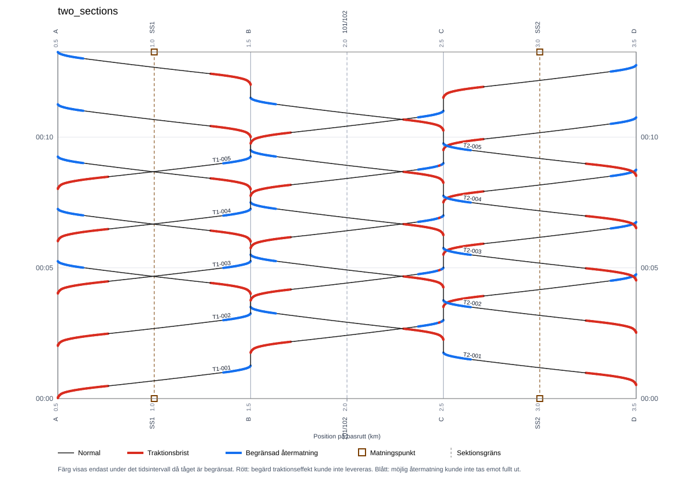
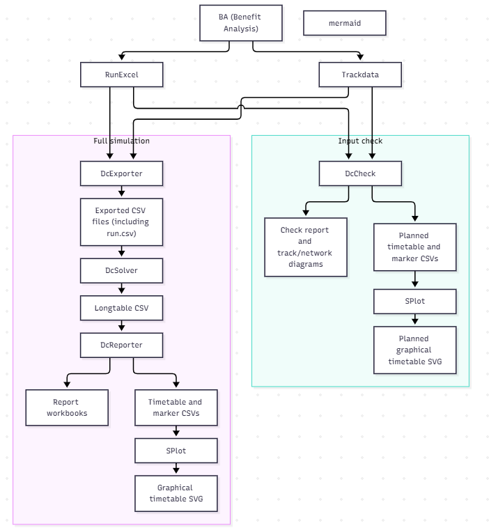

# TrainsSupply

**Railway power-supply modelling and simulation**

## Purpose

TrainsSupply simulates railway power-supply systems with moving trains. The
simulator combines railway infrastructure, an electrical grid and train
traffic to calculate voltages, currents and power flows over time.
See [Examples](#examples) for concrete study inputs and commands.

### Limitations

- The current release is limited to DC traction networks.
- Train movements and power demands are precalculated. Insufficient delivered
  power is detected, but its effect is not fed back into the train dynamics.

## Examples

### two_sections — Multi-leg traffic in both directions

The `two_sections` study contains five trains from A to D and five from D to A,
with a one-minute headway in each direction. Each train uses three RunExcel legs:

| Template | First leg | Second leg | Third leg |
| --- | --- | --- | --- |
| A-D | `A-D_timetable_A-B.xlsx` | `A-D_timetable_B-C.xlsx` | `A-D_timetable_C-D.xlsx` |
| D-A | `D-A_timetable_D-C.xlsx` | `D-A_timetable_C-B.xlsx` | `D-A_timetable_B-A.xlsx` |

The RunExcel files are located under
`D:\studies\dc-simulator-verifiering\references\two_sections`.
Trackdata contains the sheets `A-D` and `D-A`; each sheet's `trackInformation`
must match its route ID. Both views are configured in `dcsim.track.route_views`.

```bat
dcStudy --check D:\studies\dc-simulator-verifiering\conf\two_sections\two_sections.conf D:\studies\dc-simulator-verifiering
```


*Figure 1. Graphical timetable for the two_sections study.*

## Part 1 — Using TrainsSupply

### The study model

A study combines three descriptions: **track infrastructure** defines railway
positions, sections, stations and connections; the **electrical grid** defines
conductors, nodes and power installations; and **traffic** defines routes,
RunExcel templates and train departures. A template can contain several legs.
The main configuration brings these inputs together and defines the simulation
window. See [Examples](#examples) for a concrete study.

### Check and run

TrainsSupply is run from the command line or an IDE. Check the inputs first:

```bat
dcStudy --check <configuration-file> <working-directory>
```

The check validates inputs and exported train placements, and produces
reports and diagrams in the study's `checks` directory. No time step is solved.
Inspect the graphical timetable for intended routes, directions, stops and
unexplained position jumps.

After the check passes, run the simulation:

```bat
dcStudy <configuration-file> <working-directory>
```

The command exports traffic, solves the electrical network for each time step
and produces detailed results and summary workbooks.

### Result files and scenario assessment

Outputs are written under `dc/<studyId>/exports`, `results` and, when an input
check is run, `checks`. Use the study ID from the resolved configuration.

| File or group | Contents and use |
| --- | --- |
| `exports/run.csv` | Precalculated train movements, requested power and speed used as calculation input |
| `exports/nodes.csv`, `lines.csv` | Expanded electrical geometry and conductor data |
| `exports/powerInstallations.csv`, `installationConnections.csv`, `fixed_loads.csv`, `systemParameters.csv` | Exported installations, connections, fixed loads and system limits |
| `exports/track_segments.csv`, `track_stations.csv`, `track_junctions.csv` | Track geometry and markers used for position mapping and diagnostics |
| `<studyId>_longtable.csv` | Detailed input, static and result signals with time, object ID, units and result metadata; source for reports and custom analysis |
| `<studyId>_results_train.xlsx` | One sheet per train: route and physical position, base-route position, speed, voltage, current, requested and actual power, power difference and accumulated energy |
| `<studyId>_results_installation.xlsx` | One sheet per installation: terminal voltage, current, power, state and supplied, absorbed and net energy; diode station sheets also report internal losses |
| `<studyId>_results_line.xlsx` | Power losses and accumulated loss energy per electrical line |
| `<studyId>_results_system.xlsx` | Combined station, train and fixed-load power, losses, power balance and accumulated energy balance |
| `<studyId>_deviations.xlsx` | Applied thresholds, deviation periods and weak sectors for undervoltage and positive train power deficit |
| `*_graphical_timetable.csv`, `*_graphical_timetable_markers.csv` | Train paths with power differences, and station, supply-point and section-boundary markers |
| `<studyId>_graphical_timetables.txt` | Manifest listing the timetable file stems, including separate configured base routes |
| `*_graphical_timetable.svg` | SPlot rendering: red indicates traction shortfall, blue indicates curtailed regeneration; black indicates neither condition above the rendering threshold |
| `checks/<studyId>_input_check.txt`, route `.dot`/`.svg` and track-route `.svg` files | Input-check findings and electrical/track topology diagrams; planned timetable files have zero power difference because no electrical solve is performed |

`dcStudy` updates calculation results and timetable CSVs. `dcStudyGt` also
renders their SVGs using the external SPlot project. Likewise, `dcCheckGt`
adds planned SVG rendering to `dcCheck`. Old SVGs or check files can remain
from a previous run; check their timestamps before comparing them with new data.

For example, run the object-based WE study and render all configured base routes:

```bat
gradlew dcStudyGt -Pargs=D:/studies/dc-simulator-verifiering/conf/WE/WE_grid_objects_run.conf -PworkingDir=D:/studies/dc-simulator-verifiering -PstudyId=WE_objects -PsplotProjectDir=C:/pvcs_worktrees/itsolutions-splot/allProjects
```

`-PstudyId` selects the result directory for rendering; it does not change the
study ID used by the simulation. It must match `study.id`. SPlot uses its own
Gradle wrapper in the configured external project.

The main scenario question is **where, when and by how much requested traction
power needs to be reduced**. Start with the system workbook to locate demanding
periods, use the graphical timetable to identify trains and locations, then
read each train's `p_req_W`, `p_W`, `p_delta_W`, `u_V` and `i_A`. For positive
requests, the observed shortfall is `p_req_W - p_W`; divide by `p_req_W` to
express it as a fraction. Distinguish train characteristic limits and numerical
fallback from a physical network supply constraint before proposing a limit.
A proposed reduction changes network loading and must be verified in a new run.
Train motion is precalculated and is not updated by this power assessment.

For braking, inspect negative requested and actual powers separately. A blue
segment can still return part of the requested braking power. Concurrent
motoring trains can consume that power, while some is dissipated as network
losses. The deviations workbook targets positive power deficits and undervoltage;
an empty sheet does not establish unrestricted regeneration. Check its recorded
thresholds against the study's voltage level: a 600 V reporting threshold is not
a useful low-voltage criterion for a 3000 V network.

### Validate and archive

Validate representative traction, regenerative braking and train interactions.
Confirm physically consistent voltages, currents, power flows and losses;
a successful input check does not guarantee convergence or power availability.

Keep configurations, required inputs, selected reference results and a
study-specific `README.md` in Git. Record commands and assumptions needed for
reproduction, including access to externally referenced files. Generated
calculation output is normally working data.

## Part 2 — Developing TrainsSupply

### Architecture overview



The application separates input preparation, electrical calculation and
reporting. The Gradle task `dcStudy` runs the tasks `dcExporter`, `dcSolver` and
`dcReporter` in that order. They invoke `DcExporter.main`, `DcSolver.main` and
`DcReporter.main` to export traffic, solve the electrical network and produce
reports.

Track transformations connect route coordinates with physical track sections
and model positions. Reporting introduces a further coordinate: distance along
the configured graphical-timetable base route. Keep these coordinates distinct
when tracing a train through the application.

The stories below describe concrete execution paths. Each story records calls and intermediate data so another developer can
follow the execution path. Concrete study inputs are described in Examples.

### Development principles

The main package responsibilities under `org.supply` are:

| Package | Responsibility |
| --- | --- |
| `domain` | Configuration-facing concepts and input data contracts |
| `loader` | Configuration loading, validation and input construction |
| `track` | Track data and railway, route and model coordinate transformations |
| `solver.build` | Calculation network construction and train placement |
| `solver.model` | Electrical element models and stamping behavior |
| `solver.electrical` | Admittance assembly and numerical solution |
| `io` | Input/output formats, export and report I/O |
| `app` | Application entry points and orchestration |
| `utils` | Shared helpers; keep domain rules in their owning packages |

Prefer small, independently verifiable changes. Preserve the invariants recorded
in the relevant story and update its explanation when behavior changes.
Electrical verification should include Kirchhoff's current law, power balance
and line losses calculated as I²R, where applicable; solver convergence alone
does not establish physical correctness.

For reproducibility and handover, retain the code revision, configuration,
required input versions and run command with reference results. Result metadata
supports this traceability but does not replace the inputs. A useful bug report
includes these details, the failing timestep and a focused result extract.

### Story 1 — Check multi-leg traffic and draw its complete timetable

The task `dcCheck` invokes `DcCheck.main` to verify inputs without
solving time steps. `dcCheckGt` depends on `dcCheck` and then invokes the external
SPlot task `:tools:splot:splotCsv` to render the planned timetable. `dcStudyGt`
adds the same rendering step after a full study.

#### Execution sequence

1. **Gradle `dcCheckGt` -> `dcCheck` -> `DcCheck.main(args)`:** load the study
   with `DcStudyContextLoader.load(conf)` and call `DcCheck.run(context, routeId)`.
   Gradle supplies the working directory through `studyWorkingDir`.
2. **`DcCheck.run` -> input loaders:** call `GridModelLoader.load(dcsim)`,
   `TrackConfigLoader.load(dcsim, confFile)`, `SystemParametersFactory.build(dcsim)`
   and `RouteFactory.build(traffic)`. Construct `DefaultTrackTransformService`
   from the loaded track and call `CalculationNetworkBuilder.buildBase(grid)`.
   Each input stage is wrapped by `DcCheck.stage` to record success or failure.
3. **`DcCheck.run` -> diagnostic writers:** call `TrackRouteDiagram.write`,
   `ElectricalRouteCheck.inspect` and `ElectricalTopologyGraph.write` to produce
   track diagrams and electrical route diagnostics in `checks`.
4. **`DcCheck.run` -> `RunCsvWriter.write(dcsim, confFile, temporary)`:** export
   traffic into a temporary directory. Load its `run.csv` with
   `RunSampleLoader.load(runCsv)` to obtain `List<RunSample>`.
5. **`DcCheck.run` -> `checkPlacements`:** call
   `TrainPositionFactory.fromRunSamples(List.of(sample))` for each sample and
   `TrainNodeInserter.insertTrainNodes(network, List.of(train))` for each distinct
   placement. Check train IDs, route IDs and finite time, position and power.
6. **`DcCheck.run` -> `NetworkInputCsvWriter`:** call `writeTrackStations` and
   `writeTrackSegments` with the loaded track to create `track_stations.csv` and
   `track_segments.csv` in the temporary directory.
7. **`DcCheck.run` -> `DcReporter.writePlannedGraphicalTimetable(context,
   temporary, samples, transform, checks)`:** use the five-argument overload
   accepting `List<RunSample>`. It constructs `TrainPositionFactory`, calls
   `fromRunSamples(List.of(sample))`, and creates
   `PlannedTimetablePoint(timeS, trainId, sectionId, positionM)` values.
8. **`DcReporter` -> points overload and base-route mapping:** call
   `writePlannedGraphicalTimetable(context, exportDirectory, points,
   outputDirectory)` and `loadBaseRoutePositionMapper`. Read
   `report.graphical-timetable.base-route.sections` and `track_segments.csv`.
   If `base-route.id` is supplied, `loadReversedBaseRouteSections` uses
   `TrackConfigLoader.load` and `routeDirections` to determine section orientation.
9. **`DcReporter` -> timetable and marker CSVs:** map each point with
   `BaseRoutePositionMapper.map(sectionId, positionM)` and write
   `<studyId>_graphical_timetable.csv` in `checks`, with columns
   `time_s,train_id,base_route_position_m,p_delta_W`. Planned points use `0.0`
   for power deficit. Unmapped positions leave an empty position field.
   `writeGraphicalTimetableMarkers` writes station, supply-point and
   section-boundary markers to `<studyId>_graphical_timetable_markers.csv`.
10. **`DcCheck.run` -> check report:** delete the temporary directory in
    `finally`, write `<studyId>_input_check.txt` and return `CheckResult`.
    `DcCheck.main` prints the report and throws if the result is invalid.
11. **Gradle `dcCheckGt` -> external SPlot Gradle wrapper:** after `dcCheck`
    succeeds, invoke `:tools:splot:splotCsv` with `-Pinput`, `-Pmarkers`,
    `-Poutput` and `-Ptitle`. Input and output paths refer to `checks`;
    the output is `<studyId>_graphical_timetable.svg`. The external project is
    selected by `splotProjectDir` or `SPLOT_PROJECT_DIR`.

### Story 2 — Railway coordinates and electrical routes

#### Problem

Traffic describes movement along a journey, while electrical infrastructure must identify a physical location independently of travel direction. Railway kilometre references can increase or decrease, restart in another section, and cover a physical distance different from their numerical difference. A single position in metres cannot represent all these meanings.

The implementation therefore separates path positions, railway coordinates and model coordinates. It also separates a track route view from an electrical route. Both use a route ID, but serve different purposes.

| Representation | Meaning | Code |
| --- | --- | --- |
| Path position | Position along a particular route view, as supplied by traffic | `PathSample`, `RouteView` |
| Railway coordinate | Section, kilometre reference and optional track ID | `RwyCoordinate` |
| Model coordinate | Section, optional track ID and physical model position within that section | `ModelCoordinate` |
| Electrical route | Permitted source line IDs for feeding and return connections | `org.supply.domain.Route` |

#### Design decisions and difficulties

Infrastructure geometry is defined once. Opposite travel directions use separate route views over that geometry. Reversing a journey must not rebuild or reverse the physical section model.

Within each section, kilometer boards retain their configured order. The `length` of a board defines the physical distance to the next board. It must not be replaced with the numerical difference between kilometre references. Model position starts at zero independently in each section.

A route view provides samples linking path positions to railway coordinates. Interpolation is valid only within the same section and track. At a section or track change, the current implementation permits a transition interval of at most one metre. It does not interpolate kilometre references across that boundary.

Electrical route membership and physical placement are separate conditions. A train must lie on the appropriate section and a compatible track, and the branch must belong to its electrical route. Line endpoints are handled in either positional order.

#### Implementation sequence

1. **Load the section model.** `org.supply.track.TrackConfigLoader.load(dcsim, confFile)` reads `track.kilometer_boards`, `track.junctions` and configured stations, then calls `TrackLoader.load(...)`. `TrackLoader` groups boards by section without sorting. Consecutive boards become `RouteSegment` instances, using the first board's length to the next board and an accumulated section-local model position. Each section requires at least two boards. Junctions are retained in the loaded model.

2. **Load the route views.** `TrackConfigLoader` reads `track.route_data_excel` and `track.route_views`, which must be configured together. Relative workbook paths resolve against the configuration file's directory. For every configured view, `RouteViewExcelReader.read(workbookPath, sheetName, routeId)` reads `position [m]`, `trackSection`, `bisKm` and `bisMeter`, with optional `trackNumber` and `trackInformation`. The configured route ID is authoritative. Nonblank `trackInformation` must match it. Duplicate configured route IDs are rejected. The reader also requires explicit km+000 rows for each whole kilometre reference covered by each contiguous section/track interval.

3. **Load station events.** `TrackStationExcelReader.read(...)` accepts named rows with `dataType = P` and identical `fromStationAbbr` and `toStationAbbr`. Unequal names describe an interval and are not interpreted as a station event. `merge(...)` replaces configured stations whose names occur in Excel, then deduplicates exact events by name, section, railway position and track. Multiple distinct positions with the same station name remain distinct events.

4. **Load electrical routes.** `org.supply.loader.RouteFactory.build(traffic)` reads `traffic.routes`. Each route contains its ID and the configured `feeding_lines` and `return_lines`. This step creates line references; it performs no coordinate transformation or adjacency check.

5. **Transform a traffic position.** `TrainPositionFactory.fromRunSamples(...)` calls `DefaultTrackTransformService.pathToModel(routeId, positionM)`. The service calls `pathToRailway(...)`, which looks up the route view and delegates to `RouteViewMapper.toRailway(...)`. Exact sample positions return their stored railway coordinates. Positions between samples on the same section and track use linear interpolation rounded to whole metres. Within an allowed section/track transition interval, the preceding coordinate is used; the next sample itself selects the new coordinate. Nonfinite positions, unknown routes and positions outside the route range are rejected.

6. **Transform to section-local model position.** `DefaultTrackTransformService.toModel(...)` selects the section from the railway coordinate and calls `TrackSectionMapper.toModel(...)`. The mapper finds a segment containing the railway reference and scales the offset by the segment's configured physical length, rounding to whole metres. It preserves the coordinate's track ID. Increasing and decreasing kilometre references are supported. A nonzero model segment with identical railway endpoints cannot be mapped.

7. **Select electrical connections.** `org.supply.solver.build.TrainNodeInserter.insertTrainNodes(...)` uses the resulting `CalculationTrainPosition`. `routeContains(...)` matches a branch's `sourceId` against the route's feeding or return line IDs. Both endpoints must match the train's section and have compatible track IDs. A blank track ID on either side acts as a wildcard. If routes are configured, an unknown train route cannot select a branch. If no routes are configured, the implementation permits placement without route filtering for compatibility.

8. **Connect feeding and return.** A train at an eligible endpoint reuses that node. A train strictly inside an eligible branch receives a train node, and the branch is split in endpoint order with resistance proportional to physical segment length. Placement must provide both a feeding node and a return node; otherwise insertion fails. The details of rebuilding the dynamic network belong to Story 3.

#### Example: two_sections

Both route views describe the same 4000 m infrastructure. A-D runs from START to END; D-A runs from END to START. Stations are 500 m inside each end.

| Station | A-D path position [m] | D-A path position [m] | Railway coordinate |
| --- | ---: | ---: | --- |
| A | 500 | 3500 | 101 1+500 U |
| B | 1500 | 2500 | 101 0+500 U |
| C | 2500 | 1500 | 102 0+500 U |
| D | 3500 | 500 | 102 1+500 U |

Thus A-D at 1500 m and D-A at 2500 m refer to the same physical station B. The route views provide the direction-dependent mapping. The section model and electrical infrastructure remain shared. The numerical path position must never be used directly as a section-local electrical position.

#### Invariants and tests to preserve

- Preserve configured kilometer-board order and physical lengths. Changing travel direction must not change section geometry.
- Preserve section and track identity through the transformation. Equal metre values in different sections do not identify the same location.
- Keep route-view interpolation within one section and track. Preserve exact boundary samples and the explicit transition rule.
- Require both physical compatibility and electrical route membership when routes are configured. Preserve endpoint reuse and require both feeding and return connections.
- Treat stations as explicit events rather than inferring them from interval endpoint names.

The supplied JUnit tests protect these specific cases:

| Test | Existing assertions |
| --- | --- |
| `TrackLoaderTest.keepsAscendingInfrastructureGeometryIndependentOfRouteDirection` | Two ascending sections each produce two 1000 m segments with model starts at 0 and 1000 m. The fixture does not itself exercise reverse route mapping. |
| `RouteViewMapperTest.mapsWeRouteAcrossTrackSections` | Exact samples on either side of section and track transitions retain their expected section, track and railway position. It does not test interpolation inside the transition. |
| `TrackSectionMapperTest.scalesRailwayDistanceToShorterModelSegment` | A 1000 m railway-reference span maps to an 800 m physical segment, including rounding and its endpoint. |
| `TrackSectionMapperTest.scalesRailwayDistanceToLongerModelSegment` | A 1000 m railway-reference span maps to a 1200 m physical segment. |
| `TrackSectionMapperTest.mapsDecreasingRailwayCoordinates` | Decreasing railway references map to increasing model positions with correct endpoints and midpoint. |

`dcCheck` complements these unit tests by exercising exported train placement against the calculation network without solving a timestep. A successful placement check establishes that the supplied positions can be connected; it does not establish that upstream timetable generation assigned the intended station positions.

#### Current implementation limits

`DefaultTrackTransformService.toRailway(...)`, for conversion from model coordinates back to railway coordinates, is not implemented. `distanceOnRoute(...)` returns the absolute difference of two section-local model positions; it does not accumulate a journey distance across sections. It should not be treated as a general route-distance operation.

The supplied tests were inspected for this documentation, not executed here. They do not establish complete coverage of loader failures, station merging or electrical placement.

### Story 3 — Dynamic electrical network and train placement
### Story 3: Dynamic electrical network and train placement

#### Problem

The infrastructure is fixed, but train positions and requested powers change with time. Each train needs an electrical connection between feeding and return conductors at its current physical position. Connecting a train to the nearest infrastructure node would discard the resistance between that node and the train. Accumulating train nodes from earlier timesteps would also change the network incorrectly.

The implementation builds a base network once and derives a separate calculation network for each timestep. Trains at existing endpoints reuse nodes. Trains inside a conductor branch split that branch at their positions, preserving its total resistance.

#### Design decisions and difficulties

Coordinate transformation belongs to Story 2. This story starts with section-local model positions and follows how they become electrical connections. Regenerative power allocation, voltage-dependent current and nonlinear convergence belong to Story 4.

The base network contains infrastructure nodes, conductor branches, installation elements and fixed loads. The timestep network adds the current trains. Every timestep starts from the base network, rather than modifying the preceding timestep's topology.

Feeding and return connections are selected independently. Both require compatible physical coordinates and, when electrical routes are configured, membership of the train's route. Direction of travel does not determine branch endpoint order.

Sorting trains by position makes branch splitting independent of input order for distinct positions. Endpoint reuse avoids zero-length segments at infrastructure nodes. Distinct trains at the same interior position are not merged by the current implementation: their placement would produce a zero-length split branch and fail.

#### Implementation sequence

1. **Build the base network once.** `org.supply.app.DcSolver.run(...)` constructs `CalculationNetworkBuilder(trackTransform)` and calls `buildBase(grid)`. Each configured node's railway position is parsed with `RwyCoordinateParser.parse(...)` and transformed with `TrackTransformService.toModel(...)`. A `CalculationNode` retains the original node ID, section, track and model position.

2. **Create conductor branches.** `CalculationNetworkBuilder.buildBase(...)` calculates each line's length as the absolute difference between its endpoints' model positions. Resistance is `resistance_ohm_per_m × length`, with a minimum of 1e-9 ohm. A branch receives a generated ID and retains the configured line ID as `sourceId`. This source identity is subsequently used for electrical route selection and remains attached to split branches. The length calculation is a difference of section-local positions, not a general distance calculation across sections.

3. **Add installation elements.** `addSixTerminalInternalBranches(...)` adds four low-resistance internal connections per six-terminal rectifier installation. `addSubstationElements(...)` resolves feeding and return connections through `ElectricalNodeAliases.canonicalNodeId(...)`, then creates `DiodeSubstationElement` or `ThyristorSubstationElement`. Multiple connection entries are accepted only when they resolve to the same canonical node for a connection type. Missing connections and substations with identical feeding and return nodes are rejected. `addFixedLoadElements(...)` creates fixed loads using the same connection resolution. The resulting base `CalculationNetwork` has no train loads.

4. **Group traffic into timesteps.** `DcSolver.solveRun(...)` loads `run.csv` with `RunSampleLoader.load(...)` and groups samples by `RunSample.timeS`. For each group, it calls `solveTimestep(...)`. The timestep loop carries previous solved voltages and accumulated energy, but train topology is rebuilt from the base network.

5. **Transform the current train positions.** `TrainPositionFactory.fromRunSamples(...)` creates `CalculationTrainPosition` instances using the coordinate transformation described in Story 2. Each position includes train ID, route ID, section, track, path position, model position, requested power and optional speed.

6. **Select eligible branches.** `TrainNodeInserter.insertTrainNodes(baseNetwork, trainPositions)` copies the base node list and builds a new branch list. Branches whose endpoint IDs both start with `F` are treated as feeding branches; those whose endpoints both start with `R` are treated as return branches. Other branches are retained unchanged. `routeContains(...)` tests `branch.sourceId()` against the route's feeding or return line IDs. `sameTrack(...)` requires section equality and compatible track IDs. Blank track IDs on either side act as wildcards. With no configured routes, route filtering is disabled for compatibility; with configured routes, an unknown train route cannot select a branch.

7. **Reuse endpoint connections.** For each eligible branch, `isAtNode(...)` recognizes a train at either endpoint within 1e-9 m. The train is associated with that existing feeding or return node. Separate maps track each train's feeding and return placement, preventing repeated placement on adjacent branches of the same conductor type.

8. **Insert interior nodes.** `trainsInsideBranch(...)` selects unplaced trains strictly inside the branch. They are sorted by model position and then train ID. If the branch runs from a higher position to a lower position, the sorted list is reversed. Each train creates a `TRAIN_NODE` named `train_<trainId>_F` or `train_<trainId>_R`. The chain starts at the original from-node, passes through train nodes, and ends at the original to-node.

9. **Split resistance proportionally.** `addSplitBranches(...)` replaces the original branch with consecutive chain segments. Each segment receives resistance `originalResistance × segmentLength / originalLength`, and retains the original `sourceId`. Zero-length original or split segments are rejected. Branches without interior trains are retained unchanged.

10. **Create train loads.** Every train must have both a feeding and a return connection. Otherwise insertion throws `IllegalArgumentException` identifying the train, physical position and missing connection. Successful placements create `CalculationTrainLoad` instances. The timestep element list contains the resulting branches, retained non-branch infrastructure elements and a `TrainLoadElement` for each train. `insertTrainNodes(...)` returns a new `CalculationNetwork`.

11. **Solve and report the timestep.** `DcSolver.solveTimestep(...)` collects requested powers from the connected train loads and calls `solveWithFallback(...)`. The electrical solver uses the timestep topology while rebuilding the voltage-dependent train elements during its iterations. After a successful solve, `saveResults(...)` writes results. The next timestep again inserts its trains into the original base network.

#### Example: splitting a conductor

The placement test uses parallel feeding and return branches, each 1000 m long with resistance 1 ohm. Trains at 300 m and 700 m split each conductor into the following chain:

| Segment | Length [m] | Resistance [ohm] |
| --- | ---: | ---: |
| Infrastructure start to T1 | 300 | 0.3 |
| T1 to T2 | 400 | 0.4 |
| T2 to infrastructure end | 300 | 0.3 |

Each train connects between its own feeding and return node. The sum of split resistances equals the original conductor resistance. A train at 0 m instead uses the existing start nodes and leaves both conductor branches unchanged.

#### Invariants and tests to preserve

- Build each timestep's train topology from the base network. Do not retain train nodes or split branches from earlier timesteps.
- Preserve infrastructure elements and configured source line IDs when splitting branches.
- Preserve total conductor resistance through proportional splitting.
- Require both feeding and return placement for every train. Reject unsupported positions instead of silently omitting a train.
- Reuse eligible endpoint nodes. Preserve branch traversal order for both increasing and decreasing endpoint positions.
- Apply physical compatibility and configured electrical route membership together.

`TrainNodeInserterTest` contains these existing cases:

| Test | Existing assertions |
| --- | --- |
| `insertsTwoTrainNodesAndSplitsBranchDeterministically` | Four train nodes, six split branches, two train loads, and the expected 0.3/0.4/0.3 ohm chain on both conductors. |
| `rejectsTrainThatCannotBePlacedOnAnyBranch` | A train at 1200 m on the 0–1000 m fixture is rejected. |
| `treatsTrainExactlyAtExistingNodeAsPlacedWithoutChangingTopology` | A train at the start endpoint reuses feeding and return nodes, preserving node and branch counts. |
| `producesIdenticalTopologyForDifferentTrainInputOrder` | Reversing the two input trains preserves compared node IDs and positions, branch IDs, endpoints and resistances, and train-load count. |
| `producesIdenticalTopologyAcrossRepeatedRuns` | Repeated insertion into the same base fixture preserves those same topology properties. |

These fixtures use no configured electrical routes. They do not establish coverage of route filtering, reversed branch endpoints, coincident interior trains, installation aliases or base-network construction. `dcCheck` additionally exercises exported train placement without solving the nonlinear electrical equations. Successful placement does not guarantee convergence or sufficient power availability.


### Story 4 — Regenerative braking and non-receptive networks

#### Problem

A braking train can supply energy to accelerating trains, but the electrical network may be unable to absorb all the requested regenerative power. Diode substations supply the railway and block reverse current; they do not provide an unrestricted sink for braking energy. Receptivity therefore depends on simultaneous loads, conductor resistance and terminal voltages.

The implementation combines a voltage-dependent regenerative train characteristic with a timestep fallback that reduces regenerative allocations when the numerical solution is unacceptable. Reporting must use the resulting allocation and voltage. Otherwise a curtailed train could still appear to deliver its original requested braking power.

#### Design decisions and difficulties

Train power is positive for motoring and negative for regeneration. Three quantities must remain distinct:

| Quantity | Meaning |
| --- | --- |
| Requested power | Traffic input, retained as the reference for power deviation |
| Allocated power | Power passed to the solver after any fallback reduction |
| Actual power | Terminal voltage multiplied by the current delivered by the train characteristic |

An unchanged allocation does not guarantee full regeneration: the voltage-dependent characteristic can already reduce current. Conversely, fallback changes the allocation before the characteristic is evaluated.

`RegenerativeTrainElement` uses constant-power regeneration below a start voltage and a linear **current** ramp from the start voltage to the maximum voltage. This is not a linear power ramp. `DiodeSubstationElement` selects its conducting or blocked state using voltages from the preceding nonlinear iteration. These voltage-dependent elements require repeated matrix assembly and solution.

The fallback applies one common multiplier to all negative train powers and leaves positive requests unchanged. This provides a deterministic reduction policy, but it is not an optimization of individual trains, recovered energy or departure times. The fallback searches for a numerically acceptable result; failure is not by itself proof that the physical network has no solution.

#### Implementation sequence

1. **Collect the timestep requests.** After train placement, `org.supply.app.DcSolver.solveTimestep(...)` builds a requested-power map from the calculation train loads and calls `solveWithFallback(...)`. The network connections are those described in Story 3.

2. **Attempt the requested powers.** `solveWithRetry(...)` calls `SingleTimestepSolver.solve(...)` with up to 200 iterations and a voltage tolerance of 1e-3 V. It first supplies the preceding timestep's voltages. If the result is unacceptable and that map was nonempty, it retries with an empty voltage map.

3. **Create voltage-dependent train elements.** During each iteration, `SingleTimestepSolver.withTrainLoads(...)` replaces the ordinary train elements using the current power map. Negative power creates `RegenerativeTrainElement`; zero or positive power creates `TrainLoadElement`. The regenerative start voltage is currently fixed at 850 V, while the maximum voltage comes from system parameters. Train voltage guesses are initialized on each solve call; the supplied previous voltages separately inform element stamping.

4. **Apply the regenerative characteristic.** Let Q be the magnitude of allocated regenerative power, U the feeding-to-return terminal voltage, Us the start voltage and Um the maximum voltage. The generated current magnitude is:

   | Voltage region | Generated current magnitude |
            | --- | --- |
   | U < Us | Q / U |
   | Us ≤ U < Um | (Q / Us) × (Um − U) / (Um − Us) |
   | U ≥ Um | 0 |

   Below Us, `RegenerativeTrainElement.stamp(...)` linearizes constant-power generation around the current voltage guess with conductance Q/U² and Norton injection 2Q/U. In the ramp region it stamps conductance 1/r and Norton injection Um/r, where r = (Um − Us)/(Q/Us). At or above Um it contributes no generation. `regenerativeCurrentA(...)` evaluates the same characteristic for reporting.

5. **Assemble the network and select diode states.** `AdmittanceSystemBuilder.build(...)` creates the active node index and stamps the electrical elements. Disabled substations are omitted. `DiodeSubstationElement.stamp(...)` blocks when the preceding terminal voltage exceeds its emf by more than 1e-3 V. Otherwise it stamps its Norton equivalent, with conductance 1/R and injection E/R. Without preceding terminal voltages, it initially stamps as conducting.

6. **Iterate and assess the result.** `SingleTimestepSolver` solves the assembled system, compares new train terminal voltages with their guesses, and updates those guesses with relaxation factor 0.1. Convergence uses the unrelaxed voltage difference. A singular admittance matrix returns a non-converged result. `DcSolver.isAcceptable(...)` additionally requires finite returned voltages and an available, finite train terminal voltage greater than zero and no more than Um + 2e-3 V. Near the regenerative upper boundary, convergence and relaxation use the bounded iteration target described in Story 7. This acceptance check does not independently verify current or power residuals.

7. **Reduce regeneration if necessary.** If the full-request attempt is unacceptable, `solveWithFallback(...)` first sets every negative request to zero while preserving motoring requests. If this also fails, it throws `DC network is not solvable even with zero regenerative train power`. Otherwise it performs 30 bisection steps between a feasible multiplier of zero and an infeasible multiplier of one. Successful candidates update the retained solution and allocation. The returned voltages and allocated-power map always belong to the same accepted candidate.

8. **Report delivered power.** `DcSolver.powerSnapshot(...)` uses the accepted allocation and terminal voltage. `trainCurrentA(...)` returns negative current for regeneration using `RegenerativeTrainElement.regenerativeCurrentA(...)`; for motoring it evaluates `TrainLoadElement.currentA(...)`. The reported `p_W` is U × I, and `trainPowerDeltaW(...)` calculates `p_delta_W` as original requested power minus actual power. A traction shortfall therefore gives a positive deviation; curtailed regeneration gives a negative deviation. Train energy accumulation and system power accounting use the actual-power snapshot.

#### Example: allocated power versus delivered power

For an allocated request of −900 kW, a start voltage of 850 V and a maximum voltage of 900 V, a terminal voltage of 872.738 V produces approximately −577.3 A and −503.8 kW. The difference from the original request is approximately −396.2 kW if the original request was also −900 kW. The remaining requested braking power is not injected into the electrical network. This electrical model does not describe the train's mechanical braking equipment.

Simultaneous acceleration can improve receptivity, but the benefit depends on where the trains connect and the resulting voltages. Matching the sums of requested motoring and braking powers alone does not establish that every braking train can deliver its full request.

#### Invariants and tests to preserve

- Keep original requests, fallback allocations and actual delivered powers distinct.
- Preserve positive requests during regenerative fallback. Motoring current remains subject to its own train characteristic.
- Keep the regenerative current continuous at Us and zero at Um. Preserve the linear current ramp and its matrix equivalent.
- Block diode reverse conduction according to the voltage-state rule, and omit disabled substations.
- Return an accepted solution together with the exact allocation used to obtain it.
- Calculate reported train power and energy from allocation-dependent current and solved voltage.

The inspected tests provide the following coverage:

| Test class | Existing coverage |
| --- | --- |
| `RegenerativeTrainElementTest` | Full current at the start voltage; half current halfway through the ramp; zero current at the maximum voltage; constant-power and ramp-region stamps |
| `DiodeSubstationElementTest` | Conducting Norton equivalent and omission of a disabled substation |
| `AdmittanceSystemBuilderTest` | Active-node indexing, reference-node validation, branch and installation stamps, current injection handling and deterministic indexing |
| `DcSolverFallbackTest` | Unchanged allocations for two directly convergent braking/motoring cases; regenerative reduction without reducing the motoring allocation; reported regenerative current and power from the voltage-dependent characteristic |

The unchanged-allocation assertions do not establish full delivered regeneration. The reporting test checks `DcSolver.trainCurrentA(...)`, rather than an end-to-end result export. Additional regression coverage should exercise voltage-triggered diode blocking and verify that fallback allocations propagate through exported power and accumulated energy. These source tests were inspected for this story; they were not executed here.

#### Current implementation limits

The fixed 850 V start voltage is not scaled with nominal system voltage. The regenerative characteristic requires Um > Us, but the general ordering check `u_min_V < u_cutoff_V < u_max_V` does not establish that relationship. The regenerative characteristic also has no configured current cap.

Bisection relies on a useful feasible/infeasible boundary in the common allocation multiplier; nonlinear convergence is not guaranteed to be monotonic. The result is a retained acceptable candidate, not proof of an optimal allocation. A zero-regeneration failure must be investigated through motoring demand, topology, parameters and numerical behavior rather than attributed automatically to braking energy.


### Story 5 — Traffic generation from multi-leg RunExcel journeys

#### Problem

A complete train journey may consist of several BA (benefit analysis) RunExcel workbooks, one per station-to-station leg. Each workbook contains its own time series, positions and power demand. The DC simulator needs one continuous journey per train, including station dwell, and must be able to repeat that journey for several departures without treating each leg as a separate train.

The implementation separates template expansion from reading and joining the source data. `RunCsvInputFactory` expands configured departures into ordered train-leg entries. `RunCsvFromExcel` reads those entries, aligns their times and positions, fills intermediate dwell and writes the samples consumed by the electrical simulation. Existing single-leg configurations remain supported.

#### Design decisions and difficulties

Three time references must remain distinct: the train's absolute departure, the leg's relative departure within the journey, and the time values in the workbook's run sheet. The first run sample need not have the same time as the timetable departure. Alignment therefore uses the difference between the desired leg start and the first source sample, rather than simply adding all three times.

The relative departure is chosen in this order:

| Priority | Source |
| --- | --- |
| 1 | The leg's configured `departure` |
| 2 | The first departure row in the workbook's `timetable` sheet, using its `Time` column |
| 3 | The first time value in the run data |

The timetable `Time` column represents the departure used for this alignment. Its `Time s` column is not used. After alignment, the preceding leg's final run sample determines when the next leg may start. A planned timetable duration does not replace that achieved end time.

Position joining and infrastructure mapping are separate operations. The reader preserves the run sheet's `position [m]` as route position. It does not replace it with railway kilometrage from the `track` sheet. Subsequent legs receive a constant position shift so that their first point equals the preceding leg's endpoint. Story 2 describes the later conversion from route position to physical infrastructure coordinates.

Auxiliary power also needs an explicit ownership rule. A workbook may already include it in its power model, while a synthetic station dwell has no workbook power samples. The configured auxiliary demand applies to the leg and its following dwell; the model flag controls whether it must be added to the leg's source power.

#### Implementation sequence

1. **Resolve templates and expand departures.** `org.supply.loader.RunCsvInputFactory.build(...)` reads `traffic.timetable.trains` and `traffic.templates`. It accepts `template_id` and the legacy spelling `templateId`. A template with `legs` supplies an ordered list; otherwise the template itself is treated as one leg. Empty leg lists are rejected.

2. **Create one entry per train and leg.** For `count = 1`, the configured train ID is retained. For larger counts, IDs receive suffixes such as `T1-001`, and train i departs at the configured departure plus i times the headway, with i starting at zero. Count must be positive; repeated departures require a positive headway. Every expanded train receives every leg in configured order, with the same absolute train departure attached to each entry.

3. **Resolve input and per-leg settings.** Each leg requires exactly one of `run_excel` and `run_log`. Excel defaults to the `run` sheet unless `run_excel_sheet` is supplied. Relative file paths are resolved against the configuration file's directory. Missing files produce an error identifying train, template, leg number and path. Section and track IDs use leg settings first, then train settings; route ID comes from the train. Auxiliary settings use leg settings first, then template settings, with defaults of `motoring_and_auxiliaries_in_same_model = true` and `auxiliary_power_W = 0`.

4. **Pass the expanded input to the writer.** `RunCsvInput` carries aligned lists of source descriptors, train identities, departures, coordinate metadata and auxiliary settings, together with the simulation window and export resolution. `org.supply.io.export.RunCsvWriter.write(...)` passes these to `RunCsvFromExcel.writeRunCsv(...)` and writes `run.csv`. Compatibility constructors convert older Excel file/sheet inputs to `RunSource` entries and supply missing optional settings.

5. **Read a workbook.** `RunCsvFromExcel.read(...)` calls `readRunExcel(...)`, which requires the selected run sheet and a `track` sheet. `readRunSheet(...)` reads `time [s]`, `position [m]`, `primaryMotoringPower [kW]` and `primaryMotorBrakingPower [kW]`. Requested power in watts is their sum multiplied by 1000; the source braking column is expected to be negative. Source speed is read from `speed [m/s]` when available, otherwise derived from the position/time samples. `readRelativeDepartureS(...)` reads the first timetable departure from `Time`, accepting numeric Excel time or text time.

6. **Complete auxiliary demand.** For Excel input with `same_model = false`, `addAuxiliaryPower(...)` adds the configured nonnegative auxiliary demand to every run point, including regenerative points. With `same_model = true`, the leg's power is retained. Measured logs use a separate `RunCsvFromLog` reader; auxiliary-completion options are rejected for those sources because the measured power must not be supplemented by the BA policy.

7. **Align and validate a leg.** The desired absolute start is the expanded train departure plus the selected relative departure. `shiftRunPoints(...)` shifts time by desired start minus the first source time. For subsequent legs, it also shifts position by previous endpoint minus the new leg's first position. `previousLegEnds`, keyed by train ID, retains the complete preceding leg's end state. A start earlier than that end by more than 1e-9 s is rejected; equal start and end times are accepted.

8. **Fill an intermediate station dwell.** For Excel input, a positive gap between legs creates stationary points at the preceding endpoint, with zero speed and the preceding leg's configured auxiliary power. The preceding leg's section, track and route metadata are retained for these points. No dwell is added before the first leg or after the last leg.

9. **Clip and optionally resample.** The full leg endpoint is saved before clipping, so joining remains based on the complete journey even when a leg lies outside the simulation window. `clipRunPoints(...)` retains the overlap and interpolates boundary positions. With positive `export.exportResolution_s`, `resampleRunPoints(...)` uses a time grid anchored at simulation start, interpolates positions and averages piecewise-constant source power over each output interval. Zero resolution retains the clipped source sampling. Dwell is clipped and resampled through the same helpers.

10. **Resolve shared boundaries and export.** Rows are sorted by time and then train ID. `removeDuplicateTrainTimes(...)` keeps the later row for duplicate train/time entries within 1e-9 s. Consequently a next-leg start supersedes the dwell endpoint at the same timestamp. `RunCsvFileWriter` writes the common run schema, including train and coordinate identifiers, route position, requested power and speed.

#### Example: a journey with station dwell

The auxiliary-power test uses a train departing at 10:00:00. Its first leg lasts ten seconds; its second leg starts at relative time fifteen seconds. Both source legs request 20 kW at their starts.

| Time | State | Exported demand |
| --- | --- | ---: |
| 10:00:00 | First leg, auxiliaries absent from source model | 20 kW + 100 kW = 120 kW |
| 10:00:10 | Dwell after the first leg | 100 kW |
| 10:00:15 | Second leg, auxiliaries already included in source model | 20 kW |

The second leg's configured auxiliary demand is 200 kW. It is not added to that leg's source power, and would apply to a following dwell if another leg existed. The flag and configured demand must therefore accurately describe the workbook's model.

For `two_sections`, templates `A-D` and `D-A` each contain three legs. Five trains per template produce ten train journeys and thirty train-leg entries. A one-minute headway shifts every leg of each repeated journey by the same minute, preserving its internal timing.

#### Invariants and tests to preserve

- Preserve single-leg configurations, legacy template naming and compatibility constructors.
- Expand all legs for every train in configured order; shift the whole journey consistently by headway.
- Apply the documented departure precedence and reject overlap against the full preceding run's achieved endpoint.
- Preserve route positions and continuity between legs without substituting railway kilometrage.
- Add auxiliary power only when absent from the source model; use the preceding leg's auxiliary setting during its following dwell.
- Save full endpoints before clipping, and keep one sample per train at shared boundaries with the next leg taking precedence.

| Test class | Existing coverage |
| --- | --- |
| `RunCsvInputFactoryTest` | Headway expansion, original ID for a single train, expansion of every leg with inherited/overridden settings, and measured-log source construction |
| `RunCsvFromExcelTest` | Route position instead of BIS position, absolute-window clipping, omission outside the window, timetable departure fallback, touching leg boundaries, auxiliary demand during a leg and following dwell, and rejection of overlapping legs |

These tests were inspected, not executed here. The supplied tests do not directly cover every constructor, three-leg repeated journeys, or the positive-resolution resampling path.

#### Current implementation limits

Joining positions ensures numerical continuity but does not verify that the workbooks refer to the same physical station. Correct BA track/timetable matching remains an input responsibility; a consistently shifted first leg is not repaired by joining later legs. Coordinate checks and the graphical timetable provide complementary validation.

Resampling emits points on the simulation-anchored grid. An off-grid final endpoint is not guaranteed to appear as a separate output sample. Duplicate-time resolution deliberately replaces earlier boundary rows; it does not combine their powers. Changes to either behavior must account for downstream timestep and timetable consumers.

### Story 6 — Describe the grid using electrical objects

#### Problem

An explicit grid repeats nodes, conductor lines and installation connections.
A change to one station or line can require coordinated edits to several lists.
Object input describes installations and their associations, then expands them
into the same calculation model used by explicit input.

#### Input and expansion

The `dcsim` name remains the configuration namespace. Application classes are
under `org.supply`; the namespace does not select the old simulator.

Within `dcsim.grid`, `substationTypes` and `lineTypes` hold reusable parameters.
`electricalObjects` defines named `POINT`, `SUBSTATION` and `LINE` objects.
Points and substations provide railway positions per track side; line objects
reference a type and can override its parameters. `electricalAssociations`
connects objects and line ends such as `L01.L` and `L01.R`.

A fragment from the two_sections object grid illustrates the association syntax:

```hocon
electricalObjects {
  START { kind = POINT, positions { N = "101 2+000 N", S = "101 2+000 S" } }
  L01 { kind = LINE, type = standard }
  SS1 { kind = SUBSTATION, type = standard,
        positions { N = "101 1+000 N", S = "101 1+000 S" } }
}
electricalAssociations = [
  { from = START, to = "L01.L" },
  { from = "L01.R", to = "SS1.L" }
]
```

This fragment requires the type definitions and the remaining network. Expansion
produces feeding and return nodes, installation connections and conductor lines.
Routes must refer to the generated source line IDs, for example `L01.N.F` and
`L01.N.R`. The reference node must also use the expanded ID, such as `START.N.R`.
Track-side labels identify physical tracks; they do not define timetable axes.

`ElectricalObjectExpander` performs the object expansion before the ordinary
grid is loaded. `CompactGridExpander` provides the integration with the existing
input path. Subsequent network building, train insertion and solving continue
to use nodes, branches and installations. `DcStudyContext` puts the supplied
expanded `dcsim` configuration back into `scenario.dcsim`, so loaders and
reporting see the same grid. Tests constructing a context must supply that
block rather than an empty configuration when a grid is required.

The current comparison run files include an older study, reset `dcsim.grid`
to `null`, and then include the object grid to avoid merging two descriptions.
They override electrical route line IDs. Keep the included files until their
track, traffic and study settings have been separated; removing them prematurely
breaks the object study.

#### Verification

`ElectricalObjectExpanderTest`, route-check and named-node insertion tests
cover expansion and placement cases. `TwoSectionsOrderDiagnosticTest` compares
explicit and object networks and train attachments across 343 timesteps.
Retain explicit test fixtures as reference inputs even when ordinary studies
use objects. Structural equivalence alone does not establish numerical
independence of node ordering; that distinction led to Story 7.

### Story 7 — Solve the network and handle numerical boundaries

#### Equations and iteration

For each timestep, build the network at the supplied train positions. A branch
with resistance R between nodes a and b has conductance g = 1/R and current
I = g(Va - Vb). Its matrix contribution is:

```math
Y_{aa} += g,\quad Y_{bb} += g,\quad
Y_{ab} -= g,\quad Y_{ba} -= g.
```

Norton sources add conductance to Y and signed injections to j. Kirchhoff's
current law gives:

```math
Y(V^{(k)}) V^{*} = j(V^{(k)}).
```

One reference-node voltage is fixed at zero. Train voltage is the difference
between its feeding and return nodes. Diodes and voltage-dependent train loads
make the problem nonlinear: their stamps depend on the preceding voltage
estimate. `AdmittanceSystemBuilder` assembles each linearized system and
`LinearSystemSolver` solves the reduced system using Gaussian elimination.
`SingleTimestepSolver` updates train voltage guesses with relaxation:

```math
U^{(k+1)} = U^{(k)} + 0.1\,(U_{target} - U^{(k)}).
```

The production iteration limit is 200 and the voltage convergence tolerance is
1e-3 V. Convergence compares the target with the previous guess before relaxation.
See Story 4 for the train characteristic, diode stamps, acceptance checks and
regeneration fallback. Reported train power uses the accepted voltage and actual
current, P = UI. Conductor losses are I squared times R. Monitor current and
power balance independently of the convergence flag.

#### Floating networks and the upper regeneration boundary

When all relevant diodes block and regenerative trains stop injecting, a
conductor component can lose its connection to the reference node. Its absolute
voltage is then undefined. Small floating-point pivots must not be interpreted
as a valid reference. `LinearSystemSolver` checks reference connectivity through
nonzero off-diagonal matrix entries and rejects floating components. The timestep
solver treats this singular-system result as non-convergence, allowing the
existing fallback policy to handle it. This connectivity check applies to the
current branch and two-terminal Norton model.

In the two_sections diagnostic, the same network produced slightly different
linear solutions near 3600 V depending on node order. One ordering pushed the
train's iterative guess beyond the regeneration cutoff before convergence.
Its generation stamp disappeared, the feeding component floated, and the solve
failed. The other ordering converged before that switch. Cold runs reproduced
the difference, and restoring node order removed it; branch order alone did not.

`iterationVoltageTarget(...)` now uses `uMaxV` as the iteration target when a
regenerating train's guess is below the maximum and its solved voltage overshoots
by at most twice the convergence tolerance. The production numerical band is
therefore 0.002 V. This target is used for convergence and relaxation; returned
raw node voltages are retained. `DcSolver.isAcceptable(...)` uses the matching
upper allowance of 0.002 V. The physical current characteristic and configured
maximum are unchanged: current is zero at or above the physical upper limit.
Larger overshoots are not covered by this boundary rule.

#### Verified scope

After the change, both cold diagnostic orderings converged in 142 iterations,
with train voltages about 3600.001283 V and 3600.000634 V. No replayed difference
above 1 V remained over the 343 compared timesteps. The full 169-test suite passed
on the user's Windows build, and two_sections and WE object studies completed.
These checks establish the observed regression result; they do not prove
convergence for every possible network or loading condition. Keep diagnostics
and inspect balances when introducing new cases.

## Part 3 — Future work

The following directions extend the simulator's scope and capabilities:

- **Electrical sectioning** — model switching, isolation and changes to network connectivity.
- **Interactive simulation** — inspect and influence the simulation while it runs.
- **Additional electrical elements** — extend installation and device models, including onboard batteries and wayside energy storage.
- **Single-phase AC traction networks** — model AC feeding and return conductors, impedances and associated supply equipment.
- **Three-phase utility supply networks** — model the upstream high-voltage grid, transformers and connections supplying traction converters.
